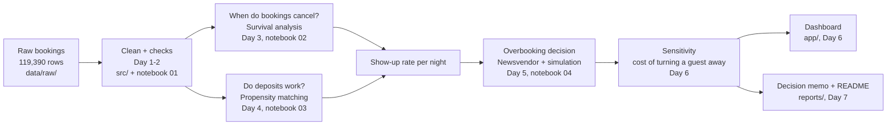

# Project map

## The question
How many rooms should each hotel overbook per night, and do non-refundable deposits change guest behaviour?

## How the pieces connect



## Folder map: what goes where, and when it fills up

```
hotel-overbooking/
├── README.md              Day 7: decision and headline at the top
├── AGENTS.md, CLAUDE.md   Done: rules for the coding agent
├── DATA_REGISTER.md       Day 1: add download date
├── AI_USE.md              Every day: log AI use
├── requirements.txt       Day 1: pin versions
├── data/
│   ├── raw/               Day 1: hotels.csv (never committed)
│   └── processed/         Day 2: cleaned bookings, nightly table
├── notebooks/
│   ├── 01_explore.ipynb       Day 1-2
│   ├── 02_survival.ipynb      Day 3
│   ├── 03_deposits.ipynb      Day 4
│   └── 04_overbooking.ipynb   Day 5-6
├── src/                   Reusable scripts: download, clean, simulate
├── app/                   Day 6: Streamlit dashboard
├── reports/               Day 7: 2-page memo, charts
└── notes/
    ├── 00_SETUP_GUIDE.md  Done
    ├── 01_PROJECT_MAP.md  This file
    └── LEARNING_LOG.md    Every step
```

## The 7 days

| Day | Question answered | Output | Skill learned |
|---|---|---|---|
| 1 | Is my data the same data the paper describes? | Rows and cancellation rates match | Setup, pandas loading, verification |
| 2 | What does the data look like, and what is wrong with it? | Clean data, deposit check, nightly table | Cleaning, groupby, SQL, charts |
| 3 | When do bookings cancel? | Survival curves by lead time and channel | Survival analysis |
| 4 | Do deposits reduce cancellations, or only look like it? | Matched comparison with caveats | Causal inference |
| 5 | How many rooms to overbook? | Policy vs flat 5% rule, in money | Newsvendor, Monte Carlo simulation |
| 6 | How sure are we? Can a manager use it? | Sensitivity charts, live dashboard | Sensitivity analysis, Streamlit, deployment |
| 7 | Can someone act on it? | Memo, README, LinkedIn post | Decision writing |

## Day 1 broken into steps
1. Setup (done)
2. Write the agent prompt: download data, load, verify 119,390 rows, cancellation rates, pin versions
3. Run it with the coding agent; check the numbers
4. Explain the code back; learning log entry
5. Write the problem statement in the README
6. Commit and push

## The working loop for every step
Concept (Claude explains) → Spec (I write the agent prompt, Claude reviews) → Generate (agent codes) → Verify (I check numbers) → Explain back (I explain, Claude corrects) → Document (I draft, we polish, then file).
